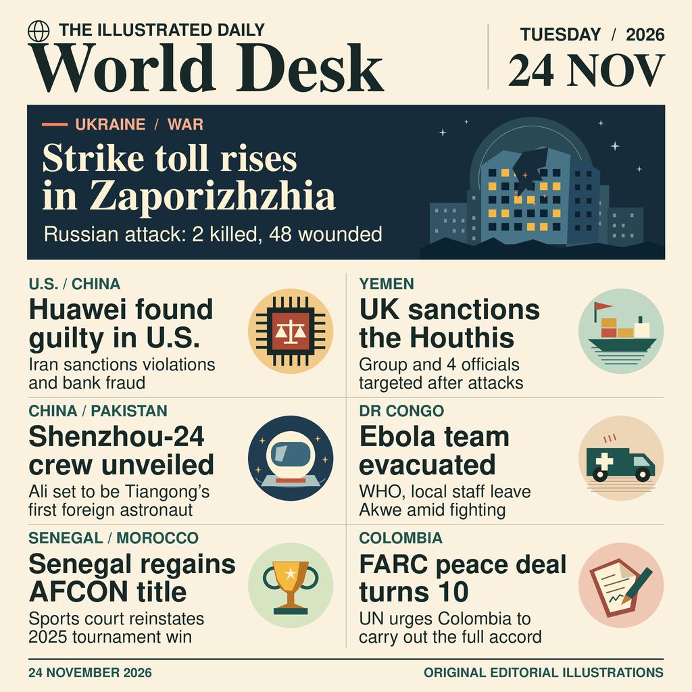

# World Desk · 24 November 2026

[](https://make.fun/bounty/news-image-20261124)

A single illustrated front page for Tuesday, 24 November 2026. The drawings are original editorial illustrations, not photographs or reconstructions. [Reporting and dates](SOURCES.md).



## Run and verify

```sh
MAKEFUN_OUTPUT_DIR=out node main.ts
python3 test_entry.py
```

The Node 22 entrypoint uses only the standard library and no network. It writes the same committed RGB PNG on each run. The test runs the program from two separate working directories and checks byte equality, PNG chunk checksums, full image data, dimensions and the byte cap.

To edit the front page, change `draw.py` and run `python3 draw.py`. The artwork build uses Pillow 11.1.0 and the URW Base35 OpenType fonts at `/usr/share/fonts/opentype/urw-base35`. The entrypoint itself requires neither Pillow nor fonts.
